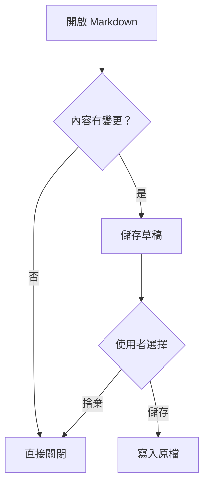
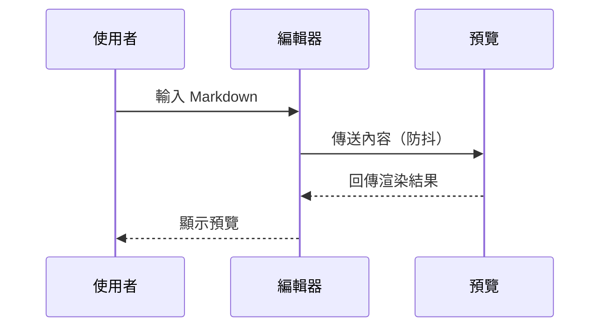

# Markdown 功能展示

> 這是一份用來展示 **MiniMdEditor** 編輯與預覽效果的範例文件。
> 建議依序閱讀，或直接切換到預覽模式（`Ctrl+2`）對照呈現結果。

---

## 1. 標題階層

# 一級標題
## 二級標題
### 三級標題
#### 四級標題
##### 五級標題
###### 六級標題

## 2. 文字樣式

一般文字、**粗體**、*斜體*、***粗斜體***、~~刪除線~~、==螢光標記==、++插入文字++、H~2~O（下標）、x^2^（上標）。

也可以混合使用：**粗體中包含 *斜體* 與 ~~刪除線~~**。

行內程式碼：`dotnet build`、`Ctrl+Shift+S`、`ViewModels/MainViewModel.cs`。

## 3. 清單

### 無序清單

- 編輯器
  - CodeMirror 6
  - WebView2
    - Evergreen Runtime
- 預覽
  - Markdig
  - highlight.js
  - KaTeX
  - Mermaid

### 有序清單

1. 開啟檔案
2. 編輯內容
3. 預覽確認
4. 匯出成品
   1. PDF
   2. Word
   3. HTML

### 工作清單

- [x] 建立編輯器骨架
- [x] 整合即時預覽
- [x] 支援數學公式
- [ ] 支援多版本歷史
- [ ] Windows 10 1809 實機驗證

## 4. 引用區塊

> 好的工具不會打斷思考。
>
> > 巢狀引用可以呈現問答或補充說明。
>
> — 專案開發筆記

## 5. 表格

| 功能 | 快速鍵 | 狀態 |
| --- | :---: | ---: |
| 新增檔案 | `Ctrl+N` | 完成 |
| 儲存檔案 | `Ctrl+S` | 完成 |
| 另存新檔 | `Ctrl+Shift+S` | 完成 |
| 切換預覽 | `Ctrl+2` | 完成 |
| 尋找／取代 | `Ctrl+F` | 完成 |

## 6. 程式碼區塊

### C#

```csharp
using Markdig;

var pipeline = new MarkdownPipelineBuilder()
    .UseAdvancedExtensions()
    .DisableHtml()
    .Build();

var html = Markdown.ToHtml(markdownText, pipeline);
```

### TypeScript

```typescript
interface EditorState {
    path: string;
    isDirty: boolean;
    wordCount: number;
}

export function markDirty(state: EditorState): EditorState {
    return { ...state, isDirty: true };
}
```

### PowerShell

```powershell
npm --prefix web install
npm --prefix web run build
dotnet build
```

### JSON

```json
{
  "theme": "followSystem",
  "fontSize": 15,
  "previewZoom": 1.0,
  "autoSaveDraft": true
}
```

## 7. 數學公式

行內公式：質能互換公式為 $E = mc^2$，圓面積為 $A = \pi r^2$。

區塊公式：

$$
\int_{0}^{\infty} e^{-x^2} \, dx = \frac{\sqrt{\pi}}{2}
$$

$$
f(x) = \sum_{n=0}^{\infty} \frac{f^{(n)}(a)}{n!}(x-a)^n
$$

## 8. Mermaid 圖表

### 流程圖



### 循序圖



## 9. 連結與圖片

- [專案 README](../README.md)
- [開發紀錄](DEV_LOG.md)
- [Markdown 官方說明](https://commonmark.org/help/)

本機圖片（請將圖片放在文件旁或 `images/` 目錄）：

```markdown

```

> 預覽與匯出會封鎖遠端圖片，避免載入外部資源；請使用本機相對路徑的圖片。

## 10. 註腳

Markdig 的進階擴充支援註腳語法[^1]，也支援較長的說明[^note]。

[^1]: 註腳會自動編號並集中顯示於文件末尾。
[^note]: 適用於補充資料、引用來源或名詞解釋。

## 11. 水平分隔線

上方內容

---

下方內容

## 12. 綜合範例：每日工作日誌

### 2026-11-21

**今日目標**

1. 完成 Markdown 範例文件
2. 驗證數學公式與 Mermaid 顯示
3. 檢查匯出 PDF 的版面

**遇到的問題**

| 問題 | 解法 | 結果 |
| --- | --- | --- |
| Mermaid 圖表過寬 | 調整節點文字長度 | 已改善 |
| 公式未置中 | 使用 `$$` 區塊語法 | 已修正 |

**待辦**

- [ ] 補上實際截圖
- [x] 校對文字
- [ ] 交給同事試閱

> 小提醒：這份文件只是展示素材，可以自由複製、修改作為自己的筆記模板。
