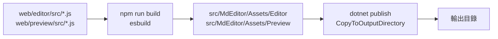

# 技術文件

本文件提供 Markdown 編輯器（MdEditor）的技術細節，包括技術棧、WebView2 訊息協定、編碼演算法、資料格式、匯出實作與偵錯方式。

## 1. 技術棧

| 項目 | 版本 / 設定 |
| --- | --- |
| 語言 | C#（nullable、file-scoped namespace、`LangVersion=latest`） |
| 執行環境 | .NET 10（`net10.0-windows10.0.19041.0`） |
| UI | WinUI 3（Microsoft.WindowsAppSDK 1.8） |
| MVVM | CommunityToolkit.Mvvm 8.4 |
| 依賴注入 | Microsoft.Extensions.Hosting 10.0 |
| 記錄 | Microsoft.Extensions.Logging 10.0（自訂檔案 provider） |
| Markdown | Markdig 1.5 |
| Word | DocumentFormat.OpenXml 3.5 |
| 測試 | xUnit 2.9 |
| 編輯器 | CodeMirror 6（`@codemirror/*`） |
| 預覽高亮 | highlight.js 11 |
| 數學排版 | KaTeX 0.19（離線） |
| 圖表 | Mermaid 12（離線） |
| Web 打包 | esbuild 0.28 |
| 目標架構 | x64、ARM64 |

套件版本集中於 `Directory.Packages.props`，`*.csproj` 不寫死版本。

## 2. 目錄結構

```text
src/MdEditor/
  App.xaml.cs                  Host、DI、啟動與單一實例
  MainWindow.xaml(.cs)         主視窗與選單
  ViewModels/MainViewModel.cs  文件與指令流程
  Models/                      DocumentViewModel、EditorViewMode、AppThemeCatalog
  Views/                       EditorHostView、PreviewHostView、PreferencesDialog、AboutDialog
  Services/                    DialogService、FileAssociationService、UiDispatcher、FileLoggerProvider
  Styles/ToolbarIcons.xaml     工具列自繪向量圖示與共用線條樣式
  Styles/Themes/               主題資源字典
  Assets/Editor/               編輯器 bundle、CSS、HTML
  Assets/Preview/              預覽 bundle、CSS、HTML、highlight.js 樣式、KaTeX CSS／字型、Mermaid
src/MdEditor.Core/
  Helpers/                     LaunchArguments、SupportedFileTypes、FileAssociationRegistration
  Models/                      設定、文件、暫存、檔案指紋、登錄項目
  Services/                    FileService、Markdown、監看、設定、最近檔案、暫存、Docx、Html
tests/MdEditor.Tests/          xUnit 測試
web/editor/src/                CodeMirror 編輯器原始碼
web/preview/src/               預覽頁面原始碼
web/build.mjs                  esbuild 打包腳本
scripts/publish-release.ps1    非 Self-Contained 發佈腳本
```

## 3. 建置與資產管線



- `web/build.mjs` 以 esbuild 打包成 `editor.bundle.js` 與 `preview.bundle.js`，輸出到 `src/MdEditor/Assets`。
- `preview.bundle.js` 內含 KaTeX；`build.mjs` 另會複製 `mermaid.min.js`、`katex.min.css` 與 KaTeX 字型到 `Assets/Preview`，並輸出 `katex-version.txt` 供 HTML 匯出組出對應版本的 CDN 字型網址。`mermaid.min.js` 不會預先載入，第一次遇到 Mermaid 區塊時才由 `preview.js` 動態插入。
- `MdEditor.csproj` 以 `<Content Include="Assets\**\*" CopyToOutputDirectory="PreserveNewest" />` 複製資產。
- `EnableMsixTooling=true` 會產生並納入 `MdEditor.pri`；非 Self-Contained 發佈若缺少此檔，啟動時會找不到 `ms-appx:///Styles/Themes/*.xaml`。
- 只有修改 `web/` 時才需要重新執行 npm 建置；日常 C# 開發可直接使用已提交的 bundle。

## 4. 啟動與 DI

`App` 建構時建立 `HostApplicationBuilder`，主要註冊：

| 介面 | 實作 |
| --- | --- |
| `IFileService` | `FileService` |
| `IMarkdownRenderer` | `MarkdownRenderer` |
| `IFileWatcherService` | `FileWatcherService` |
| `ISettingsService` | `SettingsService`（`%LocalAppData%\MdEditor`） |
| `IRecentFilesService` | `RecentFilesService` |
| `ISessionDraftService` | `SessionDraftService`（`%LocalAppData%\MdEditor`） |
| `IDocxExportService` | `DocxExportService` |
| `IHtmlExportService` | `HtmlExportService` |
| `IDialogService` | `DialogService` |
| `IUiDispatcher` | `UiDispatcher` |
| `IFileAssociationService` | `FileAssociationService` |
| `MainViewModel` | singleton |
| `MainWindow` | singleton |

`OnLaunched` 流程：

1. `AppInstance.GetCurrent().GetActivatedEventArgs()`。
2. `AppInstance.FindOrRegisterForKey("VibeCode.MdEditor.Main")`。
3. 非主要實例 → `RedirectActivationToAsync` 後結束。
4. 主要實例 → 載入設定、套用主題、建立並啟用 `MainWindow`。
5. 以 `LaunchArguments.TryGetFilePath` 解析命令列；或等待轉送啟動事件。

## 5. WebView2 訊息協定

兩邊皆使用 JSON；C# 以 `PostWebMessageAsJson` 傳送，JS 以 `window.chrome.webview.postMessage` 回傳。編輯器與預覽共用同一個 `CoreWebView2Environment`（user data folder 為 `%LocalAppData%\MdEditor\WebView2`）。

### 5.1 C# → 編輯器

| `type` | 欄位 | 說明 |
| --- | --- | --- |
| `setContent` | `text: string`, `documentId: string` | 載入文件內容 |
| `getContent` | `id: string`, `documentId: string` | 請求內容，JS 以 `content` 回應 |
| `command` | `name: string` | 格式化指令（`bold`、`italic`、`h1`…） |
| `theme` | `theme: string` | `light`／`dark`／`sepia`／`morning`／`lavender`／`nord`／`forest`／`highcontrast` |
| `wordWrap` | `enabled: bool` | 自動換行 |
| `changeMode` | `includeText: bool` | Edit 模式為 `false`，`change` 不附帶全文 |
| `focus` | — | 聚焦編輯器 |
| `readOnly` | `enabled` | 關閉保存期間切換唯讀狀態 |
| `disposeDocument` | `documentId` | 關閉文件時釋放該分頁的 `EditorState` 快取 |
| `insertText` | `documentId`, `text` | 在目前游標位置插入文字（如貼上圖片路徑） |
| `toggleTask` | `documentId`, `line`, `checked` | 切換指定行工作清單的 `[ ]`／`[x]` 狀態 |

### 5.2 編輯器 → C#

| `type` | 欄位 | 說明 |
| --- | --- | --- |
| `ready` | — | 初始化完成 |
| `change` | `documentId`, `text?` | 內容變更；`includeText=false` 時省略 `text` |
| `selection` | `documentId`, `line`, `column`, `selectionLength` | 游標與選取 |
| `scroll` | `documentId`, `percent`, `line` | 捲動比例（0–1）與頂端可見行號 |
| `shortcut` | `name` | `save`、`saveAs`、`open`、`new`、`close`、`preferences`、`viewEdit`、`viewPreview`、`viewSplit`、`nextTab`、`previousTab` |
| `pasteImage` | `documentId`, `mimeType`, `base64` | 剪貼簿貼上圖片內容 |
| `content` | `id`, `text` | 回覆 `getContent` |

### 5.3 C# → 預覽

| `type` | 欄位 | 說明 |
| --- | --- | --- |
| `render` | `html`, `theme`, `id`, `documentId` | 渲染 HTML；同文件會保留捲動比例 |
| `theme` | `theme` | 切換預覽主題 |
| `scroll` | `percent`, `line` | 依行號錨點與比例同步捲動 |
| `preparePrint` | `id` | 列印前完成全部程式碼高亮與圖片載入，完成後回 `printReady` |

### 5.4 預覽 → C#

| `type` | 欄位 | 說明 |
| --- | --- | --- |
| `ready` | — | 初始化完成 |
| `rendered` | `id` | 渲染完成 |
| `printReady` | `id` | `preparePrint` 完成 |
| `link` | `href` | 使用者點擊連結 |
| `shortcut` | `name` | 檔案操作、檢視切換、分頁切換、偏好設定或縮放快捷鍵 |
| `toggleTask` | `documentId`, `line`, `checked` | 使用者勾選或取消預覽中的工作清單 |

### 5.5 逾時與錯誤

- `getContent` 等待 5 秒、`render` 等待 60 秒、頁面 `ready` 等待 15 秒。
- JSON 解析失敗時顯示錯誤面板。
- WebView2 初始化失敗時提示安裝 WebView2 Runtime 或確認 `Assets` 完整。

## 6. Markdown 渲染與安全

`MarkdownPipelineFactory.Create()` 使用：

```csharp
new MarkdownPipelineBuilder()
    .UseAdvancedExtensions()
    .DisableHtml()
    .Build();
```

渲染流程：

1. `Markdown.ToHtml`（停用原始 HTML）。
2. 改寫相對圖片路徑：`src="images/a.png"` → `https://doc.local/images/a.png`。
3. URL 消毒：
   - 封鎖 `javascript:`、`vbscript:`。
   - `href` 封鎖 `data:`（`src` 允許，用於內嵌圖片）。
   - 相對 URL 會逐段 `Uri.EscapeDataString`，保留 `?query` 與 `#fragment`。
4. 預覽端接手：
   - Markdig 的 Mathematics 擴充會輸出 `<span class="math">\(…\)</span>` 與 `<div class="math">\[…\]</div>`，由 KaTeX 排版。
   - Diagrams 擴充會將 `mermaid` 圍欄輸出為 `<pre class="mermaid">…</pre>`，由 Mermaid 轉成 SVG。
   - 圖表與公式渲染完成後才回傳 `rendered`，確保 PDF 匯出取得完整畫面。
   - Mermaid 以 `securityLevel: 'strict'`、`htmlLabels: false` 執行，並停用外部資源。

## 7. 檔案 I/O

### 7.1 編碼偵測順序

1. UTF-32 LE BOM（`FF FE 00 00`）
2. UTF-32 BE BOM（`00 00 FE FF`）
3. UTF-8 BOM（`EF BB BF`）
4. UTF-16 LE BOM（`FF FE`）
5. UTF-16 BE BOM（`FE FF`）
6. 嚴格 UTF-8（無 BOM）
7. 系統 ANSI 代碼頁（`CultureInfo.CurrentCulture.TextInfo.ANSICodePage`，失敗回 1252）

### 7.2 換行格式

- 載入時統一轉為 `\n` 儲存在記憶體。
- 以 CRLF、LF、CR 出現次數判斷主要格式；若有 CRLF／CR 且 CRLF 不少於 LF，回傳 `CRLF`，否則 `LF`。
- 儲存時依原格式還原。

### 7.3 原子寫入

```text
1. 在目標同目錄建立 .{檔名}.{guid}.tmp
2. 寫入 BOM（若有）與內容，Flush
3. 目標存在 → File.Replace；不存在 → File.Move
4. finally 刪除殘留暫存檔
```

### 7.4 檔案指紋

`FileStamp = SHA-256(檔案位元組) + 最後寫入時間（UTC）`，用於外部變更比對。

### 7.5 衝突比較

- 啟動還原時若草稿與磁碟指紋不同，`MainViewModel` 建立 `DocumentConflict`（草稿文字、磁碟文字、指紋與時間）。
- `ConflictResolutionDialog` 提供保留草稿、載入磁碟版本、並排比較；作用中分頁優先顯示，其他分頁切換時提示。
- `ConflictCompareDialog` 使用 `LineDiffService` 的 LCS 行級差異，左右對齊並以紅綠底色標示；行數過多時降級為純並排文字。
- 原地儲存前重新計算 `FileStamp`，與 `LastKnownHash` 不同時提示覆蓋儲存、另存新檔或取消。

## 8. 設定與資料格式

### 8.1 `settings.json`

```json
{
  "Theme": "System",
  "ViewMode": "Split",
  "EditorFontFamily": "Cascadia Mono",
  "EditorFontSize": 14,
  "WordWrap": true,
  "SyncScrolling": true,
  "RecentFilesLimit": 20,
  "WindowWidth": 1120,
  "WindowHeight": 720,
  "WindowLeft": null,
  "WindowTop": null,
  "WindowState": "Normal",
  "RecentFiles": []
}
```

正規化規則：

- `Theme` 必須是支援的主題 ID，否則回 `System`。
- `ViewMode` 必須是 `Edit`／`Preview`／`Split`，否則回 `Split`。
- `WindowState` 必須是 `Normal`／`Maximized`，否則回 `Normal`。
- `EditorFontSize` 限制 10–28；`RecentFilesLimit` 限制 5–100；視窗尺寸限制 800×500 以上。
- `EditorFontSize` 同時套用至編輯器（`--editor-font-size`）與預覽（`--preview-font-size`）；`Ctrl+滑鼠滾輪` 會在 WebView 端即時更新，再延遲 500ms 回寫設定。PDF 列印固定 11pt。
- `WindowLeft`／`WindowTop` 可為 `null`；還原時會檢查是否仍位於可見螢幕，否則置中。
- 「跟隨系統」主題以 `UISettings.GetColorValue(UIColorType.Background)` 判斷系統深色，並訂閱 `ColorValuesChanged` 即時更新。

### 8.2 `drafts/session.json`

```json
{
  "SchemaVersion": 1,
  "ActiveDocumentId": "9f...",
  "ViewMode": "Split",
  "Documents": [
    {
      "DocumentId": "9f...",
      "Title": "note.md",
      "FilePath": "D:\\docs\\note.md",
      "IsDirty": true,
      "EncodingName": "UTF-8",
      "CodePage": 65001,
      "HasBom": false,
      "LineEnding": "LF",
      "LastKnownHash": "…",
      "LastWriteTimeUtc": "2026-11-03T00:00:00+00:00",
      "Revision": 1,
      "PersistText": true
    }
  ]
}
```

- 各文件內容存放於 `drafts/{DocumentId}.json`。
- `Revision` 用於判斷內容是否需要重寫；未變更的文件不會重複寫入。
- `PersistText=false` 表示已存檔且乾淨的文件不保存全文，還原時從原始檔案重新載入。
- `SchemaVersion` 不符或檔案遺失時會略過該項目。
- 儲存時會清除非目前清單的孤兒暫存檔。

## 9. 檔案監看

- `FileWatcherService` 為每個目錄建立一個 `FileSystemWatcher`，`NotifyFilter` 包含 LastWrite、Size、FileName、CreationTime；同目錄的多個檔案共用同一個 watcher。
- 事件寫入 `PendingKind`，並將計時器重設為 500 ms；計時器到期才發出 `FileChanged`。
- `MainViewModel` 以 `_watcherSuppression` 在自身儲存後抑制事件，避免回音。

## 10. 檔案關聯註冊表

全部寫入 `HKCU`：

| 機碼 / 值 | 內容 |
| --- | --- |
| `Software\Classes\VibeCode.MdEditor.Markdown`（預設值） | `Markdown 文件` |
| `FriendlyTypeName` | `Markdown 文件` |
| `DefaultIcon` | `"<exe>",0` |
| `Application\ApplicationName` / `ApplicationIcon` / `ApplicationCompany` | App 名稱／圖示／公司 |
| `shell\open` | `使用 Markdown 編輯器開啟` |
| `shell\open\command` | `"<exe>" "%1"` |
| `Software\Classes\.md\Content Type` | `text/markdown` |
| `Software\Classes\.md\PerceivedType` | `text` |
| `Software\Classes\.md\OpenWithProgids\VibeCode.MdEditor.Markdown` | 空字串 |
| `Software\Classes\Applications\MdEditor.exe\...` | 開啟命令與 `SupportedTypes` |
| `Software\RegisteredApplications\MdEditor` | `Software\VibeCode\MdEditor\Capabilities` |
| `Software\VibeCode\MdEditor\Capabilities\FileAssociations\.md` | ProgId |

`.markdown`、`.mdown`、`.mkd` 與 `.md` 規則相同。解除時只移除上述自建項目。

開啟 Windows 設定優先使用 COM `IApplicationAssociationRegistrationUI::LaunchAdvancedAssociationUI`，失敗才改用 `ms-settings:defaultapps`。

## 11. 主題

| ID | 顯示名稱 | Web 主題 | 深色 |
| --- | --- | --- | --- |
| `System` | 跟隨系統 | 依目前解析結果 | 依系統 |
| `Light` | 淺色 | `light` | 否 |
| `Dark` | 深色 | `dark` | 是 |
| `Sepia` | 護眼 | `sepia` | 否 |
| `Morning` | 晨光 | `morning` | 否 |
| `Lavender` | 薰衣草 | `lavender` | 否 |
| `Nord` | 北歐藍 | `nord` | 是 |
| `Forest` | 森林綠 | `forest` | 是 |
| `HighContrast` | 高對比 | `highcontrast` | 是 |

## 12. 匯出

### 12.1 PDF

`PreviewHostView.PrintToPdfAsync`：

| 設定 | 值 |
| --- | --- |
| 頁面 | A4（8.27 × 11.69 英吋） |
| 方向 | 直向 |
| 邊界 | 上 0.71、下 0.63、左右 0.63 英吋 |
| 背景 | 列印 |
| 頁首／頁尾 | 關閉 |

### 12.2 Word

`DocxExportService` 在背景執行緒建立 `.docx`，使用 OpenXML：

- 支援標題、段落、粗體／斜體／刪除線、行內程式碼、清單、工作清單、引用、程式碼區塊、表格、水平線、腳註。
- 圖片支援本機相對路徑；遠端圖片略過。
- 數學公式與 Mermaid 圖表目前不支援排版，分別以 LaTeX 原文與程式碼區塊呈現。
- Debug 建置的匯出會以 OpenXML 驗證器檢查文件結構；Release 跳過完整驗證以降低大文件匯出成本。

### 12.3 HTML

`HtmlExportService` 輸出單一 `.html`：

- 由 `PreviewHostView.GetRenderedHtmlAsync` 取得預覽已渲染的靜態 DOM，保留 KaTeX、Mermaid 與程式碼高亮結果。
- 依 `MainViewModel._currentTheme` 設定 `<html data-theme="...">`，並內嵌對應的 `preview.css` 與 `github.min.css`／`github-dark.min.css`。
- 本機相對圖片經 `PathSafety` 驗證後轉為 base64 data URI；遠端 `http(s)` 圖片保留原網址；`file:`、跨資料夾與無法解析的圖片移除 `src`。
- `katex.min.css` 內嵌，字型 URL 改寫為 `https://cdn.jsdelivr.net/npm/katex@<版本>/dist/fonts/...`；版本由 `web/build.mjs` 產生的 `Assets/Preview/katex-version.txt` 提供。
- 輸出含 CSP：禁止 JavaScript，只允許內嵌樣式、jsDelivr 字型與 `data:`／`http(s)` 圖片。
- 匯出前會 flush 編輯器並取消待執行的預覽更新。

## 13. 記錄

- `FileLoggerProvider` 將日誌附加到 `%LocalAppData%\MdEditor\logs\log-yyyyMMdd.txt`。
- 格式：`yyyy-MM-dd HH:mm:ss.fff [Level] Category: message`，例外會附上堆疊。
- 日誌以背景佇列寫入；啟動時清除超過 14 天的檔案。
- 寫入失敗會靜默忽略，不影響主要流程。

## 14. 測試

- 測試專案 `tests/MdEditor.Tests` 只引用 `MdEditor.Core`，不啟動 WinUI。
- 涵蓋：啟動參數、Markdown 渲染、檔案 I/O、監看、設定、最近檔案、工作階段暫存、Word 匯出、檔案關聯計畫。
- 執行：

```powershell
dotnet test tests\MdEditor.Tests\MdEditor.Tests.csproj -c Debug
```

## 15. 效能考量

- 預覽渲染與暫存皆去抖，避免高頻 I/O 與 HTML 重繪。
- Mermaid 與 KaTeX 皆為離線資產；Mermaid bundle 較大且採延遲載入，第一份含圖表的文件首次渲染會稍慢。
- Mermaid 渲染完成前不會回報 `rendered`，因此 PDF 匯出會等待圖表完成。
- 最近檔案的存在檢查使用 `Task.Run`，避免阻塞 UI。
- 編輯器與預覽各自一個 WebView2；編輯器啟動時初始化，預覽第一次需要（預覽或並排模式、PDF 匯出）時才初始化，之後重複使用。
- 編輯模式不會排程預覽渲染，切回預覽時才重新產生 HTML。
- 編輯模式只傳送輕量變更通知；全文在停止輸入、存檔、切換或暫存前才拉取。
- 預覽只高亮可見程式碼區塊，並快取 highlight.js、KaTeX 與 Mermaid 結果；同文件重繪保留捲動比例。
- 兩個 WebView2 共用同一個 `CoreWebView2Environment`，預覽渲染採 single-flight。
- 自動暫存以文件 `Revision` 判斷是否重寫，並在背景序列化與寫檔；乾淨文件不保存全文。
- 工作階段還原會平行載入各文件檔案。
- 大檔案仍會一次性載入記憶體並完整送到 WebView2；未提供虛擬捲動。

## 16. 偵錯

- 發行版關閉 DevTools；本機開發可暫時將 `AreDevToolsEnabled` 設為 `true`（請勿提交）。
- 檢視日誌：`%LocalAppData%\MdEditor\logs\`。
- 檢查 WebView2 訊息：於 JS 端 `console.log`，或暫時開啟 DevTools。
- 檔案關聯狀態可檢查 `HKCU\Software\Classes\VibeCode.MdEditor.Markdown`。

## 17. 已知技術限制

- 同步捲動為單向（編輯器依區塊行號錨點對齊預覽，預覽捲動不反向帶動編輯器）。
- 遠端圖片、原始 HTML 與跨越文件資料夾上層的本機路徑皆被封鎖。
- 單一檔案載入上限為 50 MB（超過 10 MB 會先提示確認）；剪貼簿貼上圖片上限為 20 MB。
- Word 匯出不含遠端圖片、頁首頁尾與進階樣式。
- Word 匯出不支援數學公式與 Mermaid 圖表排版。
- PDF 中的 Mermaid 圖表會沿用預覽當下主題配色，列印樣式不會重新著色圖表。
- PDF 固定 A4，尚無頁面設定 UI。
- 尚未在 Windows 10 1809 與 ARM64 實機完整驗證。
