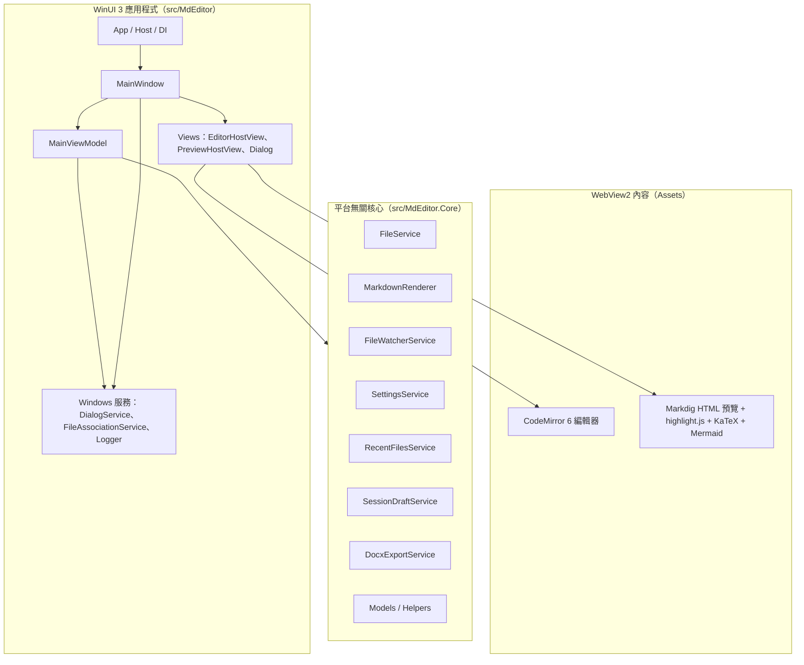
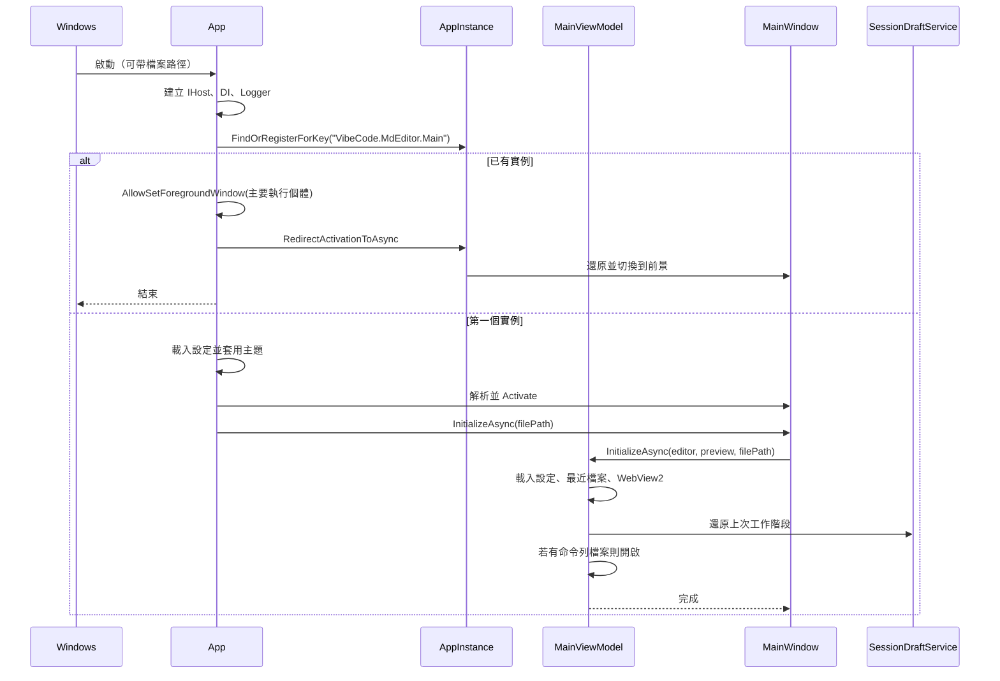
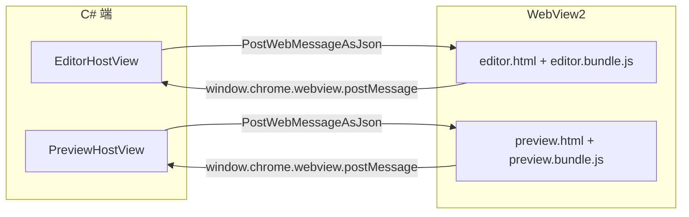
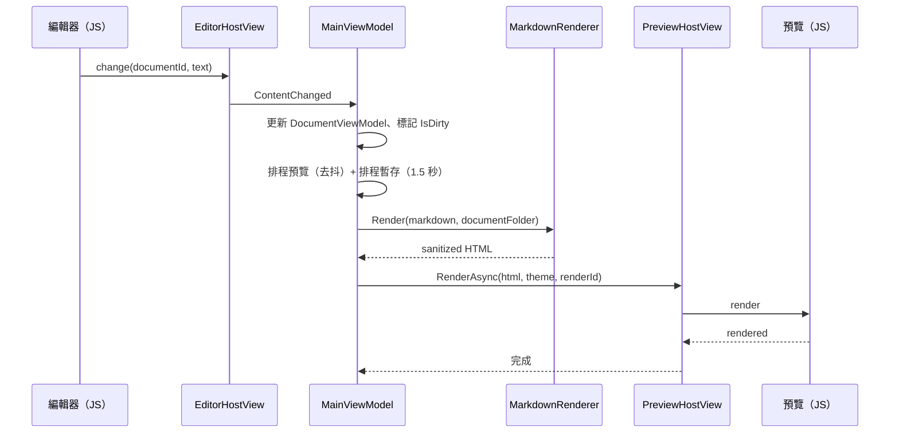
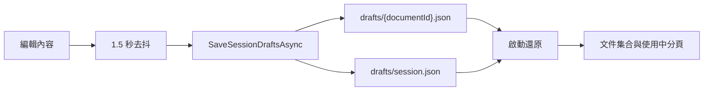
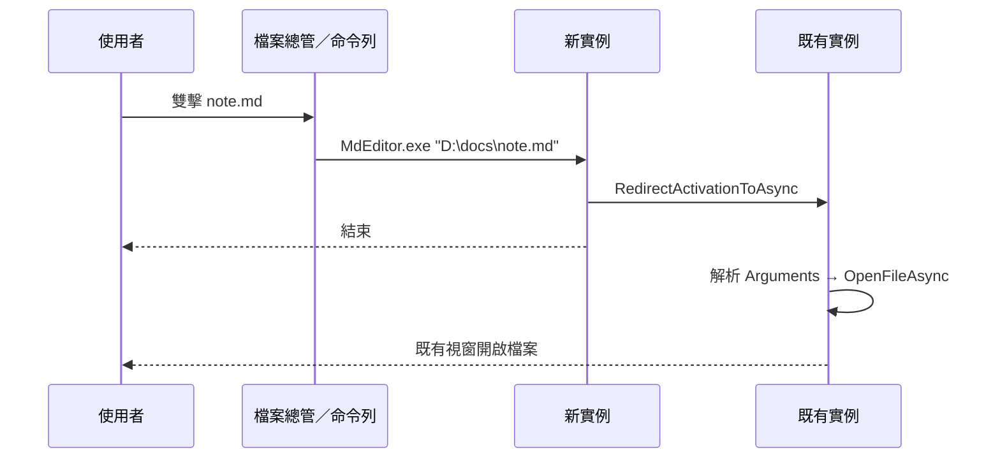

# 系統架構

本文件說明 Markdown 編輯器（MdEditor）的整體架構、分層職責、啟動流程與主要資料流。實作細節請搭配 [技術文件](技術文件.md)，設計取捨請見 [系統設計](系統設計.md)。

## 1. 架構概觀

### 分層原則

| 層 | 專案 | 職責 | 限制 |
| --- | --- | --- | --- |
| 呈現層 | `src/MdEditor` | WinUI 3 視窗、控制項、對話框、WebView2 宿主 | 不放置平台無關商業邏輯 |
| 應用層 | `src/MdEditor/ViewModels` | 文件生命週期、指令、狀態列、協調服務 | 透過介面使用服務 |
| 核心層 | `src/MdEditor.Core` | 檔案 I/O、Markdown 渲染、設定、暫存、監看、Word／HTML 匯出 | 不引用 WinUI |
| 前端資產 | `src/MdEditor/Assets`、`web/` | CodeMirror 編輯器與預覽頁面 | 由 npm 建置後複製到 Assets |

## 2. 專案與元件

### 2.1 `src/MdEditor`

| 元件 | 職責 |
| --- | --- |
| `App.xaml.cs` | 建立 `IHost`、註冊 DI、單一實例、命令列啟動參數、初始主題 |
| `MainWindow.xaml(.cs)` | 系統選單、工具列、頁籤、版面、視窗狀態、檔案關聯 UI 協調 |
| `ViewModels/MainViewModel.cs` | 文件集合、開啟／儲存／匯出／預覽／暫存／外部變更等流程 |
| `Models/DocumentViewModel.cs` | 單一文件狀態（內容、路徑、編碼、髒標記、外部變更） |
| `Models/AppThemeCatalog.cs` | 主題 ID、顯示名稱、Web 主題與背景色對照 |
| `Views/EditorHostView` | WebView2 編輯器初始化與 C#↔JS 訊息 |
| `Views/PreviewHostView` | WebView2 預覽初始化（第一次需要時）、渲染、PDF 列印、HTML 擷取 |
| `Views/PreferencesDialog` | 主題、同步捲動、檔案關聯設定 |
| `Services/DialogService` | 開檔／存檔選擇器與 ContentDialog |
| `Services/FileAssociationService` | 以 HKCU 登錄／解除檔案關聯、開啟 Windows 設定 |
| `Services/UiDispatcher` | 將事件切回 UI 執行緒 |
| `Services/FileLoggerProvider` | 以檔案記錄日誌 |

### 2.2 `src/MdEditor.Core`

| 元件 | 職責 |
| --- | --- |
| `Services/FileService` | 編碼偵測、BOM、換行偵測、原子寫入、SHA-256 檔案指紋 |
| `Services/MarkdownRenderer` | Markdig 渲染、圖片路徑改寫、URL 消毒 |
| `Services/MarkdownPipelineFactory` | Markdig pipeline 設定（Advanced Extensions、停用原始 HTML） |
| `Services/FileWatcherService` | 同目錄共用 `FileSystemWatcher` 與每個檔案 500 ms 去抖 |
| `Services/SettingsService` | `settings.json` 載入／儲存與正規化 |
| `Services/RecentFilesService` | MRU 清單、釘選、遺失檔標記 |
| `Services/SessionDraftService` | `drafts/session.json` 與各文件暫存 |
| `Services/DocxExportService` | OpenXML Word 匯出 |
| `Services/HtmlExportService` | 單一 HTML 匯出、主題樣式、圖片內嵌與 KaTeX CDN 字型 |
| `Helpers/LaunchArguments` | 命令列參數解析與支援副檔名判斷 |
| `Helpers/FileAssociationRegistration` | 檔案關聯登錄／移除計畫（純資料） |

## 3. 啟動流程

要點：

- 單一實例使用 `AppInstance`；第二個實例會把啟動參數或檔案轉送到既有視窗。
- 次要執行個體在轉送前透過 `AllowSetForegroundWindow` 授權主要執行個體；主要視窗收到啟用事件後會還原並呼叫 `SetForegroundWindow`。
- 檔案關聯的開啟命令為 `"MdEditor.exe" "%1"`，因此第二個實例可透過 `ILaunchActivatedEventArgs.Arguments` 取得路徑。
- 初始主題在建立視窗前套用，避免白色閃爍。

## 4. WebView2 架構

### 虛擬主機對應

| 主機名稱 | 對應資料夾 | 用途 |
| --- | --- | --- |
| `https://app.local/` | `<App>/Assets` | 載入編輯器與預覽頁面、CSS、bundle |
| `https://doc.local/` | 目前文件所在資料夾 | 載入本機相對路徑圖片 |

- 導覽只允許 `https://app.local/`；其他導覽會被取消。
- 文件資料夾透過 `ClearVirtualHostNameToFolderMapping`／`SetVirtualHostNameToFolderMapping` 切換。
- 編輯器與預覽共用 `WebViewEnvironmentProvider` 建立的 `CoreWebView2Environment`，user data folder 固定在 `%LocalAppData%\MdEditor\WebView2`。

### 訊息協定（摘要）

C# → JS：

| `type` | 欄位 | 說明 |
| --- | --- | --- |
| `setContent` | `text`, `documentId` | 設定編輯器內容 |
| `getContent` | `id`, `documentId` | 請求目前內容 |
| `command` | `name` | 執行格式化指令 |
| `theme` | `theme` | 切換 Web 主題 |
| `wordWrap` | `enabled` | 切換自動換行 |
| `changeMode` | `includeText` | 控制 `change` 是否附帶全文 |
| `focus` | — | 聚焦編輯器 |
| `render` | `html`, `theme`, `id`, `documentId` | 渲染預覽 |
| `scroll` | `percent` | 同步捲動比例 |
| `preparePrint` | `id` | 列印前強制完成全部高亮，回 `printReady` |

JS → C#：

| `type` | 欄位 | 說明 |
| --- | --- | --- |
| `ready` | — | 頁面初始化完成 |
| `change` | `documentId`, `text` | 內容變更 |
| `selection` | `documentId`, `line`, `column`, `selectionLength` | 游標／選取變更 |
| `scroll` | `documentId`, `percent` | 編輯器捲動 |
| `shortcut` | `name` | 編輯器或預覽的應用程式快捷鍵 |
| `content` | `id`, `text` | 回傳內容 |
| `rendered` | `id` | 預覽渲染完成 |
| `link` | `href` | 使用者點擊連結 |

完整欄位與錯誤處理請見 [技術文件](技術文件.md)。

## 5. 編輯到預覽的資料流

- 預覽渲染有去抖，避免每次按鍵都重新渲染。
- 同步捲動依 Markdown 區塊行號錨點（`data-line`）與捲動比例線性插值對齊；可在偏好設定停用。

## 6. 檔案 I/O 與監看

- `FileService.LoadAsync`：讀 bytes → 偵測 BOM／UTF-8／ANSI → 正規化換行 → 計算 SHA-256 與最後寫入時間。
- `FileService.SaveAsync`：正規化換行 → 依原編碼加 BOM → 寫入同目錄暫存檔 → `File.Replace`／`File.Move` 原子替換。
- `FileWatcherService`：每個目錄共用一個 `FileSystemWatcher`，同目錄的多個已開啟檔案共用事件來源；每個檔案仍以 500 ms 計時器去抖。
- `MainViewModel` 維護 `_watcherSuppression`，在自身儲存後短時間內忽略監看事件，避免誤報外部變更。

## 7. 工作階段暫存

- 每個文件的內容單獨存放，清單與中繼資料放在 `session.json`。
- 清單包含 `SchemaVersion`、使用中文件、檢視模式與每份文件的標題、路徑、編碼、BOM、換行、髒標記、雜湊、時間與 `Revision`。
- 只有 `Revision` 變更或暫存檔遺失的文件才會重寫內容；清單仍會更新。
- 已存檔且無未儲存變更的文件 `PersistText=false`，不保存全文；還原時直接從原始檔案重新載入。
- 載入時會忽略版本不符、重複 ID、檔案遺失的項目。
- 儲存時會刪除不屬於目前清單的孤兒暫存檔。

## 8. 外部變更與衝突處理

1. `FileSystemWatcher` 發出變更。
2. `MainViewModel` 比對目前文件的 `LastKnownHash`。
3. 若內容不同，設定 `IsExternalChange` 並顯示提示列。
4. 使用者選擇「重新載入」：
   - 有未儲存變更 → 先確認。
   - 重新讀檔並載入編輯器。
5. 使用者儲存時會更新 `LastKnownHash` 並抑制短時間內的監看事件。

## 9. 主題系統

- `AppThemeCatalog` 是主題的唯一來源，包含 ID、顯示名稱、是否深色、Web 主題名稱、資源字典 URI、編輯器與預覽背景色。
- `ThemeResourceManager.Apply` 切換 `Styles/Themes/*.xaml` 資源字典。
- `MainWindow` 設定 `RootGrid.RequestedTheme`。
- 選擇「跟隨系統」時，`MainViewModel` 以 `UISettings` 判斷系統深色，並由 `MainWindow` 訂閱 `ColorValuesChanged` 即時重新套用。
- `EditorHostView`／`PreviewHostView` 分別套用 Web 主題與 `WebView.DefaultBackgroundColor`。

## 10. 單一實例、命令列與檔案關聯

- 登錄表位於 `HKCU\Software\Classes`、`HKCU\Software\RegisteredApplications` 與 `HKCU\Software\VibeCode\MdEditor\Capabilities`。
- 不覆寫 `.md` 的預設值或 `UserChoice`；僅登錄為候選並開啟 Windows「預設應用程式」設定。

## 11. 執行緒模型

- UI 操作與 WebView2 訊息必須在 UI 執行緒。
- 檔案讀寫、Markdown 渲染、Word／HTML 匯出等使用 `async`／`Task.Run` 或非同步 API。
- `FileWatcherService` 的事件來自執行緒集區，`MainViewModel` 透過 `IUiDispatcher` 切回 UI。
- 服務層使用 `ConfigureAwait(false)`；UI 層不使用。

## 12. 部署形態

| 形態 | 說明 | 使用時機 |
| --- | --- | --- |
| Framework-dependent（本專案 Release） | 需要 .NET 10 Runtime 與 Windows App Runtime | 公開下載、檔案較小 |
| Self-Contained | 內含 .NET 與 Windows App SDK | 離線或受控環境（未列入 Release） |

發佈流程與指令請見 [建置與發佈](建置與發佈.md)。

## 13. 安全邊界

- Markdig 停用原始 HTML；URL 消毒會封鎖 `javascript:`、`vbscript:` 與非 `src` 的 `data:`。
- KaTeX 與 Mermaid 皆為本機資產，Mermaid 以 `securityLevel: 'strict'` 且不啟用 HTML 標籤渲染。
- WebView2 限制導覽來源，並關閉 DevTools、瀏覽器快速鍵與縮放控制（編輯器保留右鍵選單）。
- 遠端圖片不載入；本機圖片與相對連結皆透過 `PathSafety` 驗證，僅允許存取目前文件所在資料夾內的相對路徑（透過 `doc.local` 對應或內部開啟），阻擋 `..` 上層穿越與絕對路徑。
- 檔案載入上限為 50 MB，剪貼簿貼上圖片上限為 20 MB，避免極端輸入造成記憶體耗盡。
- 檔案關聯僅寫入 HKCU，且可完整移除。
- 日誌不記錄檔案內容或敏感資訊。
