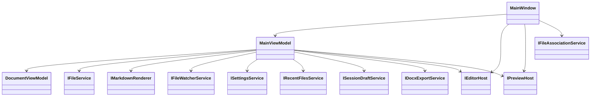
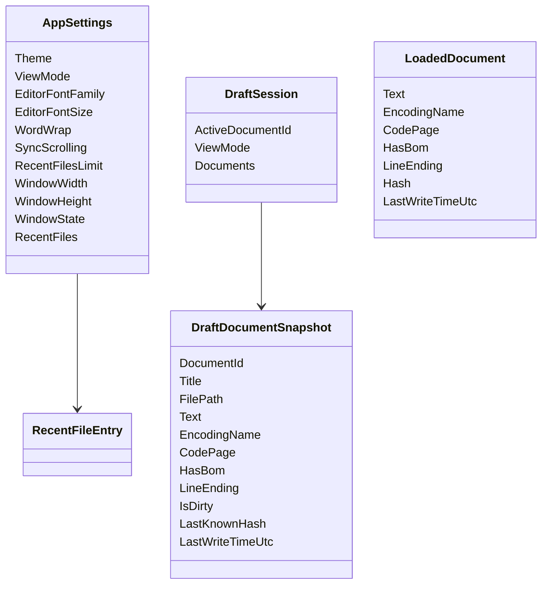
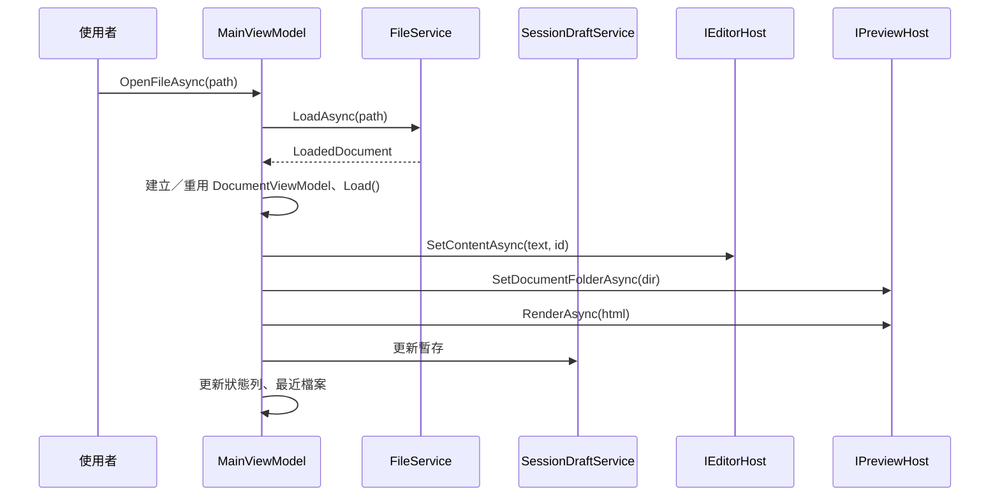
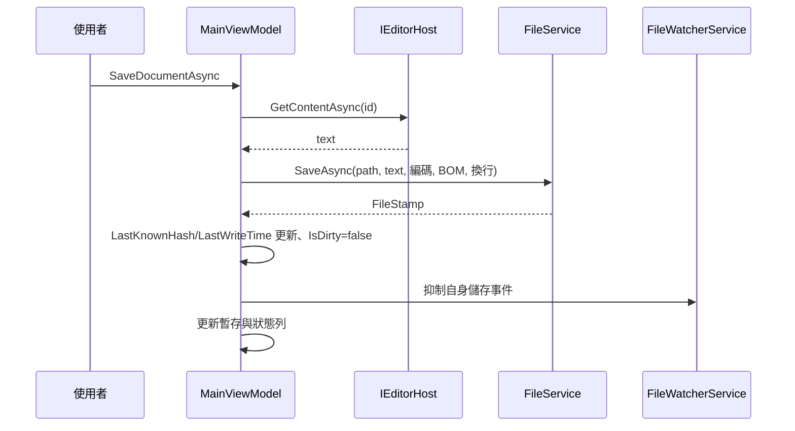
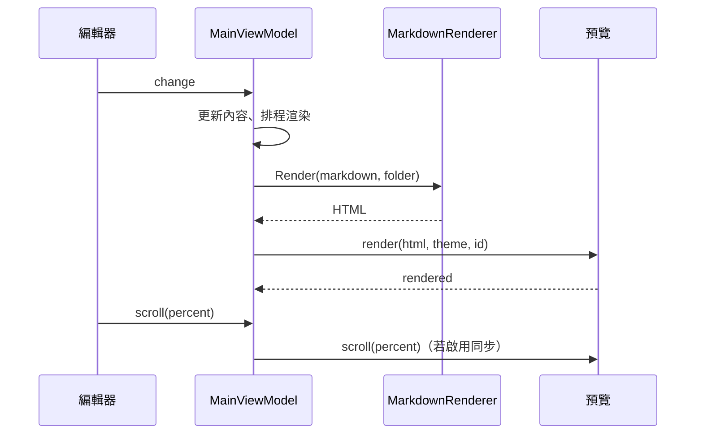
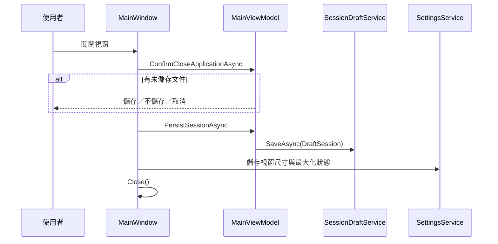
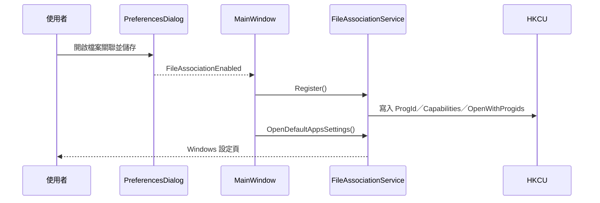
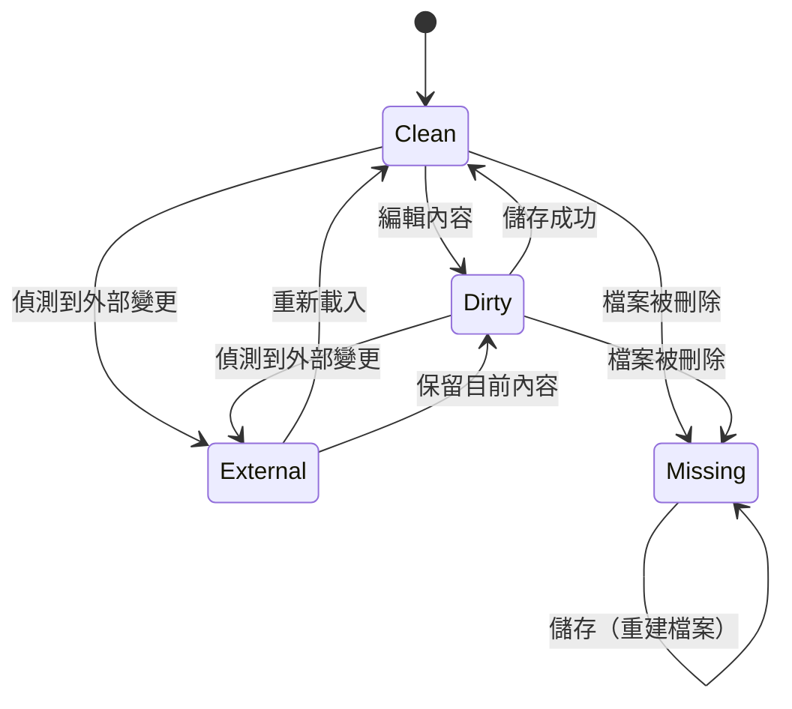

# 系統設計文件

本文件說明 Markdown 編輯器（MdEditor）的設計目標、模組職責、資料模型、關鍵流程、設計決策與測試策略。架構總覽請見 [系統架構](系統架構.md)。

## 1. 設計目標

1. **專注於 Markdown 編輯體驗**：即時預覽、格式化工具列、清楚的狀態資訊。
2. **不遺失內容**：自動暫存、工作階段還原、原子寫入。
3. **原生 Windows 體驗**：WinUI 3、單一實例、檔案關聯、系統選單與快捷鍵。
4. **可維護**：UI 與平台無關邏輯分層、服務介面化、單元測試。
5. **安全預設**：停用原始 HTML、封鎖危險 URL、不載入遠端圖片。
6. **可攜且免管理員**：非 Self-Contained 發行、HKCU 檔案關聯、使用者資料放在 `%LocalAppData%`。

## 2. 使用案例

| 編號 | 使用案例 | 主要流程 |
| --- | --- | --- |
| UC-1 | 開啟並編輯 Markdown | 開啟檔案 → 編輯 → 即時預覽 → 儲存 |
| UC-2 | 新增文件 | 新增頁籤 → 編輯 → 另存新檔 |
| UC-3 | 多文件切換 | 切換頁籤 → 各自保留內容與狀態 |
| UC-4 | 關閉後續作 | 關閉程式 → 下次啟動還原文件與檢視模式 |
| UC-5 | 外部變更 | 檔案被外部修改 → 提示 → 重新載入或保留 |
| UC-6 | 匯出 | 匯出 PDF 或 Word |
| UC-7 | 檔案關聯 | 偏好設定登錄 → Windows 設定選為預設 → 雙擊開啟 |
| UC-8 | 調整外觀 | 切換主題、同步捲動、自動換行 |
| UC-9 | 再次啟動帶檔 | 雙擊 `.md` 或命令列 → 轉送到既有視窗 |

## 3. 模組設計

### 3.1 `MainViewModel`

責任：

- 管理 `Documents`（`ObservableCollection<DocumentViewModel>`）與 `ActiveDocument`。
- 開啟／新增／儲存／另存／關閉／重新載入文件。
- 協調編輯器與預覽（載入內容、渲染、同步捲動）。
- 管理檢視模式、主題、狀態列、錯誤與忙碌狀態。
- 排程預覽渲染與自動暫存。
- 處理最近檔案、外部變更、匯出。
- 工作階段還原與持久化。

不負責：視窗控制、檔案選擇器 UI、註冊表寫入（交由服務）。

### 3.2 `DocumentViewModel`

| 欄位 | 說明 |
| --- | --- |
| `Id` | 文件識別碼，建立後不變，用於暫存檔名 |
| `Text` | 目前內容（記憶體中統一為 `\n`） |
| `FilePath` | 檔案完整路徑；未命名文件為 `null` |
| `Title` | 頁籤顯示名稱 |
| `IsDirty` | 是否有未儲存變更 |
| `EncodingName` / `CodePage` / `HasBom` | 儲存時使用的編碼 |
| `LineEnding` | `LF` 或 `CRLF` |
| `LastKnownHash` / `LastWriteTimeUtc` | 外部變更比對 |
| `IsExternalChange` / `ExternalChangeMessage` | 外部變更提示 |
| `IsMissing` | 檔案已不存在 |

衍生值：`FileDirectory`、`CharCount`、`LineCount`、`WordCount`、`DirtyVisibility`。

### 3.3 服務邊界

| 介面 | 輸入 | 輸出 | 副作用 |
| --- | --- | --- | --- |
| `IFileService` | 路徑、內容、編碼 | `LoadedDocument`、`FileStamp` | 讀寫檔案 |
| `IMarkdownRenderer` | Markdown、文件資料夾 | HTML | 無 |
| `IFileWatcherService` | 路徑 | 變更事件 | 建立檔案監看 |
| `ISettingsService` | — | `AppSettings` | 讀寫 `settings.json` |
| `IRecentFilesService` | 路徑 | MRU 集合 | 更新設定 |
| `ISessionDraftService` | `DraftSession` | `DraftSession?` | 讀寫 `drafts/` |
| `IDocxExportService` | Markdown、輸出路徑 | `.docx` | 寫入檔案 |
| `IFileAssociationService` | — | 狀態／動作 | 寫入 HKCU、開啟設定 |

## 4. 資料模型

- `AppSettings` 與最近檔案存在同一個 JSON。
- `LoadedDocument` 是 `FileService` 的回傳值，不直接被 UI 使用。
- `DraftDocumentSnapshot` 是 `DocumentViewModel` 與 `SessionDraftService` 之間的中介。

## 5. 關鍵流程

### 5.1 開啟檔案

- 若路徑已開啟，會切換到既有頁籤。
- 不支援的副檔名不會加入最近檔案。

### 5.2 儲存

### 5.3 預覽與同步捲動

### 5.4 關閉程式與還原

啟動時反向執行：`SessionDraftService.LoadAsync` → 建立文件 → 還原使用中分頁與檢視模式。

### 5.5 檔案關聯

## 6. 文件狀態機

- `IsDirty` 控制頁籤星號與關閉提示。
- `IsExternalChange` 控制提示列；重新載入前若有 `IsDirty` 會先確認。
- `IsMissing` 表示檔案已不存在，儲存時會重新建立。

## 7. 錯誤處理策略

| 情境 | 處理 |
| --- | --- |
| 檔案讀取失敗 | 顯示錯誤對話框，不建立文件 |
| 儲存失敗 | 顯示錯誤，保留 `IsDirty` |
| WebView2 初始化失敗 | 在對應區域顯示安裝提示與例外訊息 |
| JSON 訊息格式錯誤 | 顯示錯誤面板 |
| 設定檔損毀 | 備份為 `settings.json.corrupt-*`，回退預設值 |
| 暫存清單損毀 | 忽略該次還原 |
| 檔案關聯寫入失敗 | 偏好設定內顯示 InfoBar，記錄日誌 |
| 未處理例外 | 記錄 Critical 日誌 |

## 8. 設計決策

### ADR-001：以 WebView2 + CodeMirror 6 作為編輯器

- **理由**：成熟的 Markdown 編輯體驗、語法高亮與擴充性；避免自製文字編輯器。
- **代價**：需 WebView2 Runtime、C#↔JS 橋接、跨進程訊息處理。

### ADR-002：預覽由 C# Markdig 產生 HTML

- **理由**：與 Word 匯出共用 Markdig pipeline；可在 C# 層統一消毒與路徑改寫。
- **代價**：每次內容變更需往返 C# 與 WebView2（已用去抖降低頻率）。

### ADR-003：非 Self-Contained 作為公開發行

- **理由**：檔案較小、便於更新；Windows App Runtime 與 .NET Runtime 可共用。
- **代價**：使用者需先安裝執行環境；文件與 Release 需清楚說明。

### ADR-004：檔案關聯只寫 HKCU、不強設預設

- **理由**：免管理員、可完全移除、符合 Windows 10/11 的 UserChoice 保護。
- **代價**：使用者需在設定頁手動選擇一次。

### ADR-005：工作階段暫存存於 `%LocalAppData%`

- **理由**：不污染文件資料夾、可跨檔案位置還原、與使用者設定集中管理。
- **代價**：使用者需知道資料位置才能手動清除。

### ADR-006：UI 與核心分層

- **理由**：`MdEditor.Core` 可在沒有 WinUI 的測試專案中驗證。
- **代價**：部分功能（如 PDF、WebView2）仍只能在 App 層測試。

## 9. 測試策略

| 層級 | 方式 | 範圍 |
| --- | --- | --- |
| 單元測試 | xUnit | Core 服務、參數解析、檔案關聯計畫、編碼與換行 |
| 建置驗證 | `dotnet build` | 全專案編譯與警告 |
| 格式驗證 | `dotnet format --verify-no-changes` | 程式碼風格 |
| 手動／UI 自動化 | WinUI + UIAutomation | 啟動、偏好設定、視窗狀態、檔案關聯 UI |
| 發行驗證 | 解壓縮後啟動 | x64／ARM64 非 Self-Contained 產物 |

目前自動化測試涵蓋 40 個案例（v0.7.0）。

## 10. 後續工作

- 自動儲存與當機復原策略。
- 自訂尋找／取代面板。
- 同步捲動改為行號對齊。
- PDF 頁面設定。
- Windows 10 1809 與 ARM64 實機驗證。
- 版本歷史與多份暫存。
